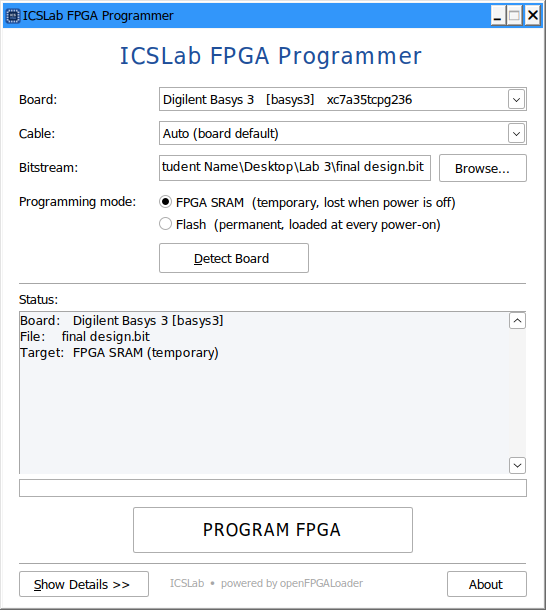
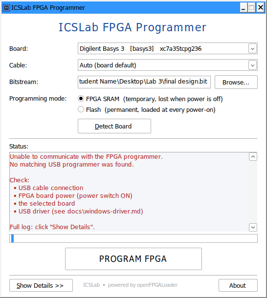
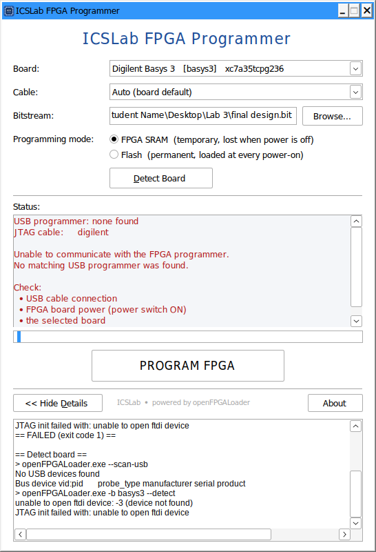
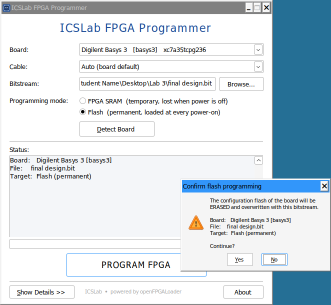
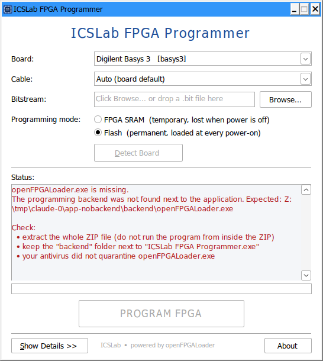
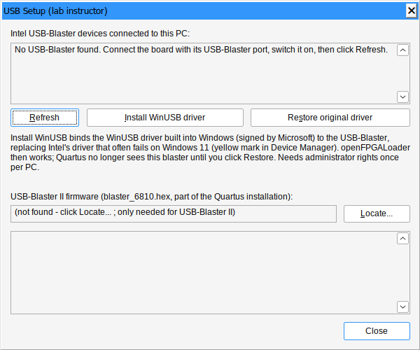
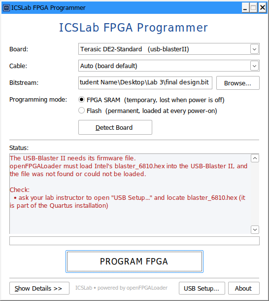
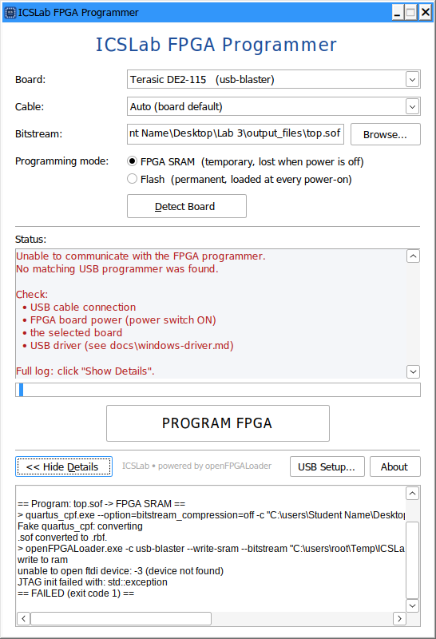
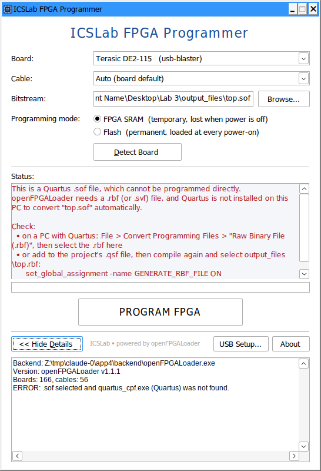

# ICSLab FPGA Programmer

A simple Windows application for programming FPGA boards in a teaching
laboratory. No command line, Python, MSYS2 or CMake needed. Download, extract,
run.



## For students

1. Connect your FPGA board to USB.
2. Power on the board.
3. Open **ICSLab FPGA Programmer.exe**.
4. Select your board.
5. Select the `.bit` file (**Browse…**, or drag the file onto the window).
6. Click **PROGRAM FPGA**.
7. Wait for **"✓ FPGA programmed successfully."**

*FPGA SRAM* (default) loads the design until the board is switched off.
*Flash* stores it permanently and asks for confirmation first.
More details: [docs/student-guide.md](docs/student-guide.md).

Developed by ICSLab.

FPGA programming backend:
openFPGALoader
<https://github.com/trabucayre/openFPGALoader>

> ICSLab FPGA Programmer uses openFPGALoader as its FPGA programming backend.
> openFPGALoader is an independent open-source project.

### Troubleshooting

| Problem | What to do |
|---|---|
| **Board not detected** ("Unable to communicate with the FPGA programmer") | Check the USB cable (PROG/JTAG port), the power switch, and try another USB port. Click **Detect Board**. |
| **Intel USB-Blaster with a yellow mark** in Device Manager (DE2 boards, Windows 11) | Instructor: **USB Setup...** > **Install WinUSB driver**. |
| **USB driver issue** ("Windows blocks access to the programmer") | The programmer needs the WinUSB driver. Ask your instructor ([docs/windows-driver.md](docs/windows-driver.md)). Close Vivado/Quartus Hardware Manager. |
| **Wrong board selected** | Choose *Auto Detect / Generic JTAG*, click **Detect Board** and use the *Possible board* shown. |
| **Malformed bitstream** ("The bitstream file is not valid") | Select the generated bitstream (Vivado: `<project>.runs/impl_1/<top>.bit`), check that generation succeeded and targets your FPGA. |
| **JTAG device not found** ("no FPGA answered") | Board power off, wrong board, or jumpers/mode switch wrong. |
| **Flash programming failure** | Program in *FPGA SRAM* mode first. Keep the board connected until the end. |

**Show Details** always shows the complete openFPGALoader output.

| | |
|---|---|
|  |  |
|  |  |

|  |  |
|  |  |

(Screenshots taken under Wine. On Windows the controls use the native Windows 10/11 theme.)

## For lab instructors

* **Distribution:** `ICSLab-FPGA-Programmer-v1.2.1-win64.zip`. Students
  extract it anywhere (Desktop, Downloads, a USB stick) and run the `.exe`.
  No installation or administrator rights. An optional per-user installer
  (`ICSLab-FPGA-Programmer-Setup.exe`, Inno Setup) is built by CI.
* **Quartus `.sof` files:** students can select the `.sof`. The application
  uses an up-to-date `<top>.rbf` next to it if present, otherwise converts it
  with Quartus's `quartus_cpf` (uncompressed `.rbf`, as JTAG configuration
  requires). Every Quartus installation is found, on any local drive:
  `<drive>:\intelFPGA*\<version>` and older Quartus II releases in
  `<drive>:\altera*\<version>` (plus `QUARTUS_ROOTDIR` and `PATH`). They are
  tried newest first; if a version cannot convert the file (e.g. a Cyclone II
  `.sof` from the original DE2, supported only up to Quartus II 13.0 SP1) the
  next older one is used. Tip: add `set_global_assignment -name GENERATE_RBF_FILE ON` and
  `set_global_assignment -name ON_CHIP_BITSTREAM_DECOMPRESSION OFF` to the lab
  template `.qsf` so every compile also writes the `.rbf` (works on PCs
  without Quartus too).
* **Lab board list:** edit `lab-boards.txt` next to the `.exe` to choose which
  boards appear first. All boards supported by openFPGALoader
  (`openFPGALoader --list-boards`, read at runtime) are listed below them.
* **USB drivers:** read [docs/windows-driver.md](docs/windows-driver.md)
  before the first lab session. For Intel USB-Blaster / USB-Blaster II boards
  (DE2, DE10, ...) whose Quartus driver shows a yellow mark on Windows 11,
  click **USB Setup...** > **Install WinUSB driver** once per PC (binds the
  WinUSB driver built into Windows; USB-Blaster II firmware
  `blaster_6810.hex` is located automatically in the Quartus installation).
* **Settings** (last board, mode, folder) are stored per user in
  `%APPDATA%\ICSLab\FPGA Programmer\settings.ini`. The last *file* is never
  remembered and nothing is ever programmed without a click on
  **PROGRAM FPGA**.

## How it works

```text
ICSLab FPGA Programmer.exe        (Win32 GUI, ~1 MB, static)
        |  CreateProcess, stdout+stderr captured on a worker thread
        +--> backend\openFPGALoader.exe   (upstream CLI + 1 small Windows path fix, static)
                |  libusb / libftdi
                +--> USB/JTAG programmer --> FPGA board
```

The GUI only builds openFPGALoader command lines and interprets the output:

| Action | Command (example) |
|---|---|
| start-up | `--Version`, `--list-boards`, `--list-cables` |
| Detect Board | `--scan-usb`, then `-b basys3 --detect` (or `-c <cable> --detect`) |
| PROGRAM FPGA, SRAM | `-b basys3 --write-sram --bitstream "C:\Users\Student Name\Desktop\Lab 3\final design.bit"` |
| PROGRAM FPGA, Flash | `-b basys3 --write-flash --bitstream "…"` |

* `backend\openFPGALoader.exe` is located relative to the GUI (never via `PATH`).
* `OPENFPGALOADER_SOJ_DIR` is set to `backend\share\openFPGALoader` so that
  flash programming finds the spiOverJtag bridge bitstreams.
* stdin of the backend is `NUL`, so it can never wait for keyboard input.
* Progress lines (`Loading: [====    ] 45.00%`) drive the progress bar. A
  moving "marquee" bar is shown when the backend reports no percentage. The
  percentage is never faked.
* Errors are translated into short explanations; the raw output stays in
  *Show Details*.

### Source layout

```text
ICSLab-FPGA-Programmer/
├── src/
│   ├── main.cpp                   entry point
│   ├── MainWindow.cpp/.h          Win32 GUI
│   ├── OpenFPGALoaderBackend.cpp/.h  command generation, quoting, output parsing,
│   │                              error mapping (portable, unit tested)
│   ├── ProcessRunner.cpp/.h       child process + pipes (Windows)
│   ├── DriverSetup.cpp/.h         USB-Blaster status, WinUSB setup (elevated), firmware lookup
│   └── Settings.cpp/.h            %APPDATA% settings
├── resources/                     icon, manifest, version info, README.txt, lab-boards.txt
├── tests/                         unit/process tests + fake openFPGALoader
├── patches/                       backend patch (cygpath fix)
├── installer/                     Inno Setup script (optional installer)
├── scripts/build-release.sh       full Windows release build (Linux host)
├── docs/                          student guide, driver guide, screenshots
├── LICENSES/, README-licenses.txt third-party notices
├── openfpgaloader.pin             backend version selection
└── CMakeLists.txt
```

The openFPGALoader sources are the root of this repository.

## Building

### Full release (recommended, Linux or WSL)

```bash
sudo apt install mingw-w64 libz-mingw-w64-dev cmake ninja-build pkg-config \
                 p7zip-full zip file wine64      # wine64 only to run the tests
ICSLab-FPGA-Programmer/scripts/build-release.sh
```

Output:

```text
ICSLab-FPGA-Programmer/release/
├── ICSLab-FPGA-Programmer/
│   ├── ICSLab FPGA Programmer.exe
│   ├── backend/openFPGALoader.exe, backend/share/openFPGALoader/*.gz, backend/VERSION.txt
│   ├── docs/, LICENSES/, lab-boards.txt
│   ├── README.txt
│   └── README-licenses.txt
├── ICSLab-FPGA-Programmer-v1.2.1-win64.zip
├── SHA256SUMS.txt
└── dependencies.txt          (DLL imports of both executables)
```

The script builds the backend with openFPGALoader's own MinGW-w64 procedure
(`cmake/Toolchain-x86_64-w64-mingw32.cmake`, `CROSS_COMPILE_DEPS=ON`: static
libusb, libftdi and zlib), builds the GUI, runs the tests through Wine, and
**fails if either executable imports a DLL that is not part of Windows**.

### GUI only

```bash
cmake -S ICSLab-FPGA-Programmer -B build-gui \
      -DCMAKE_TOOLCHAIN_FILE=ICSLab-FPGA-Programmer/cmake/mingw-w64-x86_64.cmake
cmake --build build-gui
```

On a Linux host without the toolchain file, only the portable core and its
unit tests are built (`ctest`).

### Tests

`icslab_tests.exe [path\to\openFPGALoader.exe]` covers backend discovery,
Windows argument quoting (including
`C:\Users\Student Name\Desktop\Lab 3\final design.bit`, checked by a real
child process), board/SRAM/flash command generation, bitstream file names,
error return codes, stdout/stderr capture, non-interactive stdin, progress
parsing, and the behaviour when openFPGALoader is missing. With the real
backend path it also runs integration tests without hardware (board list,
unknown board, no programmer connected).

### Backend version

`openfpgaloader.pin` selects the backend: `OFL_SOURCE=local` (this
repository's sources at the built commit, the default) or
`OFL_SOURCE=upstream` + `OFL_REF=<tag|sha>`. The GitHub Actions workflow can
override it manually (*Run workflow* → `ofl_source`, `ofl_ref`). Updating the
backend is always a deliberate change. `backend\VERSION.txt` in every release
records version, commit and patches.

### CI

[`.github/workflows/windows-release.yml`](../.github/workflows/windows-release.yml):
cross-build on Ubuntu → tests on `windows-latest` (extracted into a path with
spaces, plus GUI start-up check) → Inno Setup installer → on tag `icslab-v*`,
assets attached to a GitHub release. A "corresponding source" ZIP
(repository + libusb + libftdi sources) is produced for LGPL compliance.

## Licenses

ICSLab FPGA Programmer (the GUI) is © ICSLab, Apache-2.0. openFPGALoader is
© Gwenhael Goavec-Merou and contributors, Apache-2.0. Statically linked
libraries: libusb (LGPL-2.1+), libftdi1 (LGPL-2.1), zlib, MinGW-w64 runtime,
GCC runtime (GPL-3.0 with the Runtime Library Exception). See
[README-licenses.txt](README-licenses.txt) and [LICENSES/](LICENSES/).

### Corresponding source

For the LGPL libraries: the CI job publishes
`ICSLab-FPGA-Programmer-v<version>-corresponding-source.zip` next to every
release (`CORRESPONDING_SOURCE=1 scripts/build-release.sh` builds it locally).
